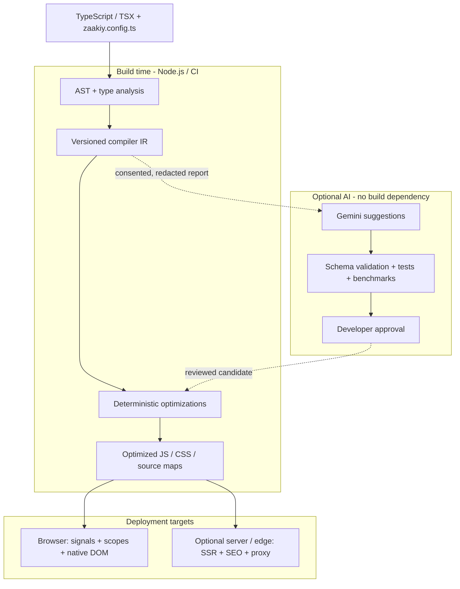

# ZaakiyJS

> **AI-assisted. Compiler-first. Signal-driven. Native DOM.**
>
> **Project status: runtime frozen on `main` for UAT (2026-11-26).** PRs #99 and #100 are merged; the integrated runtime tree exactly matches the CI-certified candidate. All 29 pre-merge workflows passed across the two PRs. 24 internal packages passed packed-consumer validation. The supported compiler-first native DOM and SSR/hydration slices have automated browser evidence; broader TSX composition, browser-version policy, manual accessibility review, application UAT and publication authorization remain open. No public npm release has been verified. See [main integration certificate](#main-integration-certificate--2026-11-26).

ZaakiyJS is an independent **TypeScript/TSX frontend framework** inspired by React, Angular and Vue, designed to compile declarative components into precise native DOM updates. It combines a fine-grained reactive runtime, SOLID/MVVM application architecture, brand-driven CSS, integrated networking/async primitives, hybrid SEO rendering and optional **reviewed Gemini optimization**.

**Repository:** [sanukhandev/zaakiyjs](https://github.com/sanukhandev/zaakiyjs) · **Proposed npm scope:** `@zaakiyjs/*` (ownership not yet verified) · **Engineering rules:** [AGENTS.md](AGENTS.md)

## Why ZaakiyJS?

The product goal is not to copy existing framework APIs. It is to deliver an integrated **verified frontend runtime** where the compiler and development tools can explain and validate signal dependencies, DOM mutations, component lifetimes, asynchronous requests and architectural boundaries.

| Design principle | Intended behavior |
| --- | --- |
| Independent runtime | No required React, Angular, Vue or Zone.js runtime |
| Compiler-first | TSX → AST → semantic analysis → versioned IR → optimized JS/CSS/maps |
| Precise DOM | Hoist static nodes; update only affected text, properties, attributes, class and style |
| One reactive model | Signals, computed values, effects, batching and automatic dependency tracking |
| Hierarchical ownership | App → route → feature → component scopes with deterministic cleanup |
| TypeScript + SOLID/MVVM | Typed Views, signal-backed ViewModels, domain Models, service contracts and adapters |
| Native-first styling | Tailwind-inspired utilities without a Tailwind runtime; brand config drives CSS |
| Optional AI | Gemini proposes changes; local validation, tests, benchmarks and developer review authorize them |
| Independent npm releases | One monorepo, package-specific SemVer, changesets and publish gates |


## Architecture at a glance

GitHub renders the Mermaid source below directly in this README. This is the **architecture and product direction**; the implemented subsets and certification evidence are described below. Not every capability in the diagram is released.



The standard build path is deterministic and works **with AI disabled**. Server-side rendering, dynamic SEO and proxy services are optional; browser runtime code must not import the compiler, AI or server-only modules. For package boundaries and independent npm releases, see the [monorepo guide](docs/development/monorepo-packages.md) and [release runbook](docs/releasing/independent-npm.md).

## Feature specifications

### 1. Compiler and rendering

- Compiler-generated native DOM bindings; **no mandatory Virtual DOM** or component-wide rerenders on a signal change.
- Versioned IR nodes for static markup, reactive text/properties, event handlers, conditionals, keyed lists, components, style tokens and compatibility requirements.
- Static hoisting, safe constant folding, dead-code elimination, dependency narrowing, CSS extraction and code splitting without altering side effects.
- Typed HTML/SVG, typed component props/events, refs, nested composition, stable keyed DOM identity, input focus preservation and source-map diagnostics.
- Deterministic, offline builds with pinned inputs; Vite tooling for development, build and HMR.

### 2. Reactivity, state and lifecycle

- `signal`, lazy `computed`, `effect`, `batch`, `untrack`, scope cleanup and controlled `flushSync`.
- Local state with **top-down unidirectional data flow**; explicit actions/callbacks for writes.
- App-scoped singleton providers for global state, route/feature scoped stores and hierarchical context injection; request-scoped isolation for SSR.
- Lifecycle policies: initialize once per owner, mount, activate, deactivate, KeepAlive, suspend/resume and dispose. Caches are bounded, and effects/listeners/requests must be cleaned up.
- Memoization of derived state and pure expressions, plus lazy component/route/resource loading.

### 3. SOLID, MVVM and page adapters

- **Model:** domain types, business invariants, repository contracts.
- **ViewModel:** owner-scoped signals, derived state, actions, resources, tasks, validation and error states.
- **View:** accessible TSX with declarative bindings and typed callbacks.
- **Page Adapter:** route parameters, data loaders, provider composition, view model construction and SEO/render policy.
- **Infrastructure:** HTTP clients, proxy adapters, cache, storage and external services.
- Architecture-aware CLI scaffolding and planned static checks for forbidden imports, circular dependencies and lifetime violations. Trivial presentational components do not require artificial ViewModels.

### 4. Zaakiy Styles, branding and UI

- An independent **Tailwind-inspired utility CSS compiler**, not a Tailwind wrapper or mandatory dependency.
- One typed `zaakiy.config.ts` for brand identity, colors, typography, spacing, shape, layout, appearance modes and motion.
- Native CSS variables, layers, nesting, responsive/container queries, scoped branding, modern color functions and fluid sizes with browser-aware fallbacks.
- Atomic CSS generation, variant compilation, deduplication, minification, style recipes and explicit handling of dynamic utility classes.
- Optional accessible **UI primitives**, brand-aware components and editable page templates (dashboards, auth, CRUD, settings).
- Optional **Zaakiy Motion**: CSS transitions/keyframes, presence/exit, keyed list/layout animations, view transitions, gestures and springs; reduced motion respected.

### 5. HTTP, secure async and proxy

- Typed Fetch HTTP client with request, response and error **interceptors**, validation, redacted tracing and bounded safe retries.
- Signal-aware `createResource()` reads and `createTask()` mutations, with concurrency policies, cache invalidation, stale-result protection and loading/error states.
- Native **AbortController/AbortSignal** with manual cancellation, navigation/scope disposal, timeouts, merged signals and typed cancellation reasons. Never patch global Promises.
- Optional **server-only Proxy Router** with named upstreams, authentication/authorization, allowlisted egress, SSRF/redirect protections, rate limits and observability. Never bundle secrets into browser code.
- Shared cache/data consistency policies connecting ViewModels, stores, routes and rendered content; server-side idempotency for consequential mutations.

### 6. Routing, server rendering and dynamic SEO

- Client-side and nested routing, page adapters, guards, lazy layouts and route-level data loaders.
- Planned **SSG, SSR, hybrid rendering, hydration and incremental/on-demand regeneration** for dynamic CMS, product, job, article and listing pages.
- Dynamic SEO metadata, canonical URLs, social tags, Schema.org JSON-LD, robots, locale/hreflang and paginated sitemaps.
- Public/private cache separation, correct HTTP status codes, authenticated cache invalidation and indexability auditing.
- Optional analytics, ads and consent packages without tracking or advertising runtime in the framework core.

### 7. AI, verification and developer diagnostics

- Gemini is opt-in and executes in Node/CI only. Advisory analysis and schema-validated optimization proposals never bypass deterministic compilation.
- Candidate IR/CSS optimizations require allowlisted passes, semantic checks, security/accessibility validation, repeated benchmarks and **explicit developer approval**.
- Planned **Verified Runtime** diagnoses scope leaks, stale requests and ownership violations; **Zaakiy Trace** visualizes signal → resource → network → DOM causality.
- Architecture-as-Code and CI contracts track SOLID/MVVM boundaries, runtime size, DOM mutations, accessibility and browser regressions.

## Developer experience (proposed)

### One-command startup

```bash
npx @zaakiyjs/cli@latest start --project my-app
# choose Minimal, Standard or Enterprise preset
cd my-app
pnpm dev
```

**The CLI source is implemented but not published to npm.** The `start --project` workflow is validated inside the pnpm workspace; standalone npm scaffolding deliberately refuses the unpublished `0.0.0` package set. `zaakiy dev` delegates to the generated project's development script.

### CLI generation

```bash
zaakiy g component UserCard
zaakiy g feature users --architecture mvvm
zaakiy g page products --layout StoreLayout
zaakiy g layout Dashboard
zaakiy g adapter ProductPage
zaakiy g viewmodel Product
zaakiy g model Product
zaakiy g store Cart --scope app
zaakiy g context Workspace
zaakiy g provider Auth
zaakiy g custom-signal UseCounter
zaakiy g service ProductApi
zaakiy g middleware Auth --target route
zaakiy g interceptor AuthToken
zaakiy g proxy Catalog
zaakiy g resource Products --abortable
zaakiy g task SaveProduct --abortable
zaakiy g form Checkout
zaakiy g recipe PrimaryButton
zaakiy g animation FadeUp
zaakiy seo audit
zaakiy analyze architecture
zaakiy ai analyze --consent
```

Generators should create strict, typed artifacts and applicable tests, update imports/routes safely, detect conflicts and support `--dry-run` and noninteractive use.

### Illustrative component syntax

```tsx
import { signal, computed } from "@zaakiyjs/core";
import { mount } from "@zaakiyjs/dom";

function Counter() {
  const count = signal(0);
  const double = computed(() => count.value * 2);

  return (
    <main class="flex flex-col gap-3 p-6">
      <h1 class="text-xl font-bold">Count: {count.value}</h1>
      <p>Double: {double.value}</p>
      <button class="bg-primary rounded-lg px-4 py-2"
              onClick={() => count.value++}>
        Increment
      </button>
    </main>
  );
}

mount(() => <Counter />, document.getElementById("app")!);
```

The intended runtime updates only the two dependent text bindings; the component setup does not execute again on each write. This is a **design illustration**, not compilable current ZaakiyJS code.

## npm package ecosystem

The proposed **27 individually versioned** `@zaakiyjs/*` package boundaries are organized below. The certified packed-consumer report covers 24 internal packages, including `image`; `ai`, `devtools` and `testing` are not part of that validated package set.

| Domain | Modules |
| --- | --- |
| Framework foundation (7) | `core`, `signals`, `dom`, `compiler`, `styles`, `vite-plugin`, `cli` |
| Application architecture (5) | `store`, `forms`, `router`, `compat`, `async` |
| Networking (2) | `http`, `proxy` |
| UI, image and motion (5) | `ui-primitives`, `ui`, `templates`, `image`, `motion` |
| Rendering and monetization (5) | `ssr`, `seo`, `analytics`, `ads`, `consent` |
| AI and quality (3) | `ai`, `devtools`, `testing` |

Only the needed packages should be installed and bundled. These are **planned package boundaries**, not published modules. A separate `create-zaakiyjs` initializer is optional, but `@zaakiyjs/cli start --project` is the chosen public convention.

### Independent npm publication

ZaakiyJS uses a **single repository** and plans **independent SemVer and npm publishing per module**, not synchronized version numbers.

- Each publishable package owns `package.json`, stable exports/types, changelog, README, tests and release artifacts.
- Changesets track package-specific updates and dependency-induced version changes.
- CI validates affected packages **and their dependents**; publication requires pack/install verification, security and API review.
- Publish only changed modules, in dependency order when necessary, using verified npm ownership and preferably npm Trusted Publishing (OIDC).
- CI and release-hardening workflows are configured. Public publication is not authorized; no verified public npm release exists.

Read the [release runbook](docs/releasing/independent-npm.md) and [package boundary guide](docs/development/monorepo-packages.md).

## Performance and quality targets

The original engineering targets below remain design budgets. The [measured results](#measured-performance) apply to the specific pinned production fixtures, not every application or supported API.

| Metric | Initial target |
| --- | --- |
| Minimal reactive + DOM runtime | ≤ 12 KiB gzip, excluding app and optional packages |
| Gemini dependency in browser core | 0 bytes |
| Unrelated DOM mutations after isolated signal update | 0 |
| Owner/lifecycle cleanup | No retained owned effects/listeners after disposal |
| Build reproducibility | Identical hashes with pinned inputs/config |
| Browser validation | Chromium, Firefox, WebKit for declared targets |
| Accessibility | WCAG 2.2 AA-oriented tested component behavior |
| Performance comparisons | Reproducible p50/p95, memory, DOM mutations and gzip/brotli against equivalent workloads |

Quality gates include strict TypeScript, unit tests, compiler golden/behavioral tests, real DOM and Playwright integration, security/privacy checks, SSR/SEO and accessibility tests, and independent package install validation.


## Main integration certificate — 2026-11-26

**Verdict: `CERTIFIED_FOR_MAIN_INTEGRATION_AND_UAT` — public beta and npm publication not certified.**

The runtime is frozen for application UAT. Only confirmed correctness, security, compatibility or certification blockers may reopen the frozen scope. This is an engineering evidence record, not a third-party accreditation.

| Integration record | Pinned evidence |
| --- | --- |
| Signals PR | [#99](https://github.com/sanukhandev/zaakiyjs/pull/99), reviewed head [afb71fd8](https://github.com/sanukhandev/zaakiyjs/commit/afb71fd8e9f175271e832fac34c776c2570c51ed), 11/11 workflows passed |
| Signals merge | [1ef1ed3](https://github.com/sanukhandev/zaakiyjs/commit/1ef1ed38264576979fbd5d3962898b1c2c70e054) |
| Final runtime PR | [#100](https://github.com/sanukhandev/zaakiyjs/pull/100), reviewed head [e1a72096](https://github.com/sanukhandev/zaakiyjs/commit/e1a72096b86db8700d7ab222a099e080b8857c0c), 18/18 workflows and 54/54 check runs passed |
| Tested CI merge commit | [c99536fd](https://github.com/sanukhandev/zaakiyjs/commit/c99536fd1c631258880a712614c0be5ecf8c5731) |
| Integrated runtime on main | [d9db3fdd](https://github.com/sanukhandev/zaakiyjs/commit/d9db3fddd8638fb680e609e92331c7b52efdefea) |
| Exact certified Git tree | `a3bdca5c8ea76af38e98dc8bb99c01a4cafa780a` |
| Reviews | [#99](https://github.com/sanukhandev/zaakiyjs/pull/99#pullrequestreview-6069622207), [#100](https://github.com/sanukhandev/zaakiyjs/pull/100#pullrequestreview-6069622562) |

PR #99 was merged first; PR #100 was then retargeted to main, marked ready, and merged against its reviewed head. The retargeted synthetic merge and resulting main merge both have the same Git tree as the tested CI merge commit (no file differences). Certification is anchored to that tested tree, not a claim of a separate fresh successful run on the post-merge commit. Post-merge CI and application UAT remain separate acceptance gates.

### Measured performance

All numbers below are from the pinned CI artifacts, not estimated targets. H4 compares production SSR/hydration for a reference scalar-list application, with 100, 1,000 and 10,000 rows, 50 measured samples and 10 warmups per case, 36 cases across Chromium 156.0.8078.4, Firefox 157.0 and WebKit 27.2. Node 22.23.5; React 19.2.4, Vue 3.5.44 and Angular 21.2.26. Timing is the fixture's hydration metric, not total navigation, rendering or network latency.

| 10,000-row hydration p95 (ms), lower is better | ZaakiyJS | React | Vue | Angular |
| --- | ---: | ---: | ---: | ---: |
| Chromium | 22.86 | 30.86 | 32.00 | 1,813.90 |
| Firefox | 17.00 | 19.55 | 26.00 | 2,278.10 |
| WebKit | 24.00 | 438.00 | 40.00 | 1,184.65 |

These comparisons are specific to the tested workload and framework versions. Angular's fixture performs additional DOM mutations; do not infer general framework superiority from this matrix.

| Controlled 10K p95 median reduction across three independent trials per browser | vs historical main | vs previous compact-v3 |
| --- | ---: | ---: |
| Chromium | 79.79% | 14.48% |
| Firefox | 83.58% | 11.67% |
| WebKit | 78.52% | 8.11% |

The paired run uses five pinned source versions (historical main `b0da54d2`, #99 `afb71fd8`, compact-v2 `185478c`, compact-v3 `78c1e3c` and the tested final candidate), 1K and 10K sizes, 50 measured samples per variant/size/trial, nine independent trials and 4,500 measured samples. Identical fixture and lockfile hashes and Node version were verified. Trial percentiles were recomputed from raw samples. No persistent p95 increase above 5% was flagged under the configured all-three-trials gate. Against previous compact-v3, 1K median p95 increased 4.25% in Chromium and 8.11% in Firefox; one Firefox 10K trial was 30.55 ms, just above the 30 ms target. These limitations remain documented, not hidden by the aggregate verdict.

| Metric | Measured | Target | Result |
| --- | ---: | ---: | --- |
| Chromium 10K hydration p95 (H4) | 22.86 ms | ≤35 ms | Met |
| Firefox 10K hydration p95 (H4) | 17.00 ms | ≤30 ms | Met |
| WebKit 10K hydration p95 (H4) | 24.00 ms | ≤40 ms | Met |
| 10K SSR HTML + full hydration JS gzip | 62.26 KiB (63,754 B) | ≤85 KiB | Met |
| Clean application hydration JS gzip | 11.28 KiB (11,552 B) | ≤12 KiB | Met |
| Full hydration benchmark JS gzip | 13.40 KiB (13,723 B) | ≤12 KiB | Missed |
| CSR application JS + CSS gzip | 8.44 KiB (8,643 B) | ≤8 KiB | Missed |

The clean application bundle excludes benchmark instrumentation; the full harness is retained for historical comparison. The production CSR JavaScript alone is 7,919 bytes gzip; the target above includes CSS. The 10K HTML is 50,031 bytes gzip. All KiB use 1,024 bytes. The remaining size targets are not waived for beta; existing CI regression budgets passed.

| Full comparative hydration JS | Raw bytes | Gzip bytes | Brotli bytes |
| --- | ---: | ---: | ---: |
| ZaakiyJS | 48,695 | 13,723 | 12,066 |
| React | 319,662 | 72,613 | 61,288 |
| Vue | 131,496 | 41,295 | 36,133 |
| Angular | 217,482 | 68,362 | 60,536 |

The compiler emits a static browser entry for supported flat-v3 routes. The production fixture uses the restricted `@zaakiyjs/ssr/client/flat` entry, with the generic attachment module absent from Rollup's retained module report. Complex routes retain the generic path. See the [compact-v3 ADR](docs/adr/compact-v3-flat-keyed-hydration.md) and [SSR package documentation](packages/ssr/README.md).

### Quality and release evidence

| Validation | Certified candidate result |
| --- | --- |
| Quality | 131/131 test files; 1,035 tests passed, 1 skipped; zero failed |
| H4 hydration matrix | 36/36 cases passed; zero initial ZaakiyJS hydration DOM mutations |
| H4 owner disposal | 600 cycles over 100/1,000-row cases and three engines; zero retained disposed owner weak references, stale events or incorrect adopted roots in those cases |
| Packed consumer/reproducibility | 24 internal packages validated; 184 matching build hash entries |
| CSP, text injection, keyboard and automated axe checks | Passed in all three browsers for tested release fixtures |
| Manual screen-reader testing | Not verified |
| Vite build and browser behavior | Passed |

**Evidence links (GitHub access and artifact retention apply):**

- [Quality workflow](https://github.com/sanukhandev/zaakiyjs/actions/runs/45557294946)
- [H4 comparative workflow](https://github.com/sanukhandev/zaakiyjs/actions/runs/45557295178) · [matrix artifact](https://github.com/sanukhandev/zaakiyjs/actions/runs/45557295178/artifacts/14999866983) · [owner disposal artifact](https://github.com/sanukhandev/zaakiyjs/actions/runs/45557295178/artifacts/14996711900)
- [Paired benchmark and profiling](https://github.com/sanukhandev/zaakiyjs/actions/runs/45557295139) · [paired review](https://github.com/sanukhandev/zaakiyjs/actions/runs/45557295139/artifacts/14996764259) · [candidate build and module attribution](https://github.com/sanukhandev/zaakiyjs/actions/runs/45557295139/artifacts/14997315086)
- [Production CSR comparison](https://github.com/sanukhandev/zaakiyjs/actions/runs/45557295214) · [CSR artifact](https://github.com/sanukhandev/zaakiyjs/actions/runs/45557295214/artifacts/14997545932)
- [Vite production profiling](https://github.com/sanukhandev/zaakiyjs/actions/runs/45557295315)
- [Release hardening](https://github.com/sanukhandev/zaakiyjs/actions/runs/45557295072) · [package evidence](https://github.com/sanukhandev/zaakiyjs/actions/runs/45557295072/artifacts/14996611004) · [security/heap evidence](https://github.com/sanukhandev/zaakiyjs/actions/runs/45557295072/artifacts/14995389402)

Reproduce using the pinned workflows at the certified tree with locked dependencies, production builds and the declared browser matrix. GitHub artifact downloads may expire; this record preserves the key measurements, exact commit identities and limitations.

### Remaining release gates

Application UAT on integrated main, manual screen-reader testing, supported browser-version policy, broader feature coverage and final public-beta review remain open. The packed-consumer report explicitly identifies 49 publication blockers: 24 placeholder `0.0.0` versions, 24 missing package license declarations, and one missing approved root LICENSE. Ownership of the `@zaakiyjs` npm scope is unverified. No npm publication or release tag is authorized by this certificate. The automated security and memory results are scoped to the tested workloads and are not guarantees for arbitrary applications.

## Development roadmap

| Phase | Deliverables |
| --- | --- |
| M0 — Contracts | TSX semantics, IR, signal scheduler, owner scopes, monorepo and CI foundation |
| M1 — Reactive core | Counter/Todo/keyed lists compiled to direct DOM updates with disposal tests |
| M2 — Styling and DX | Brand CSS engine, Vite/HMR, CLI starter and typed diagnostics |
| M3 — Application layer | Stores, MVVM, forms, adapters, routing, HTTP and async cancellation |
| M4 — UI, rendering and server | UI primitives, motion, compatibility, SSG/SSR/hydration, SEO and secure proxy |
| M5 — Verified runtime and AI | Lifecycle diagnostics, causal traces, validated Gemini proposals and measured quality contracts |
| M6 — Beta and ecosystem | Docs, benchmarks, migration, analytics/ads/consent and independent npm releases |

The initial compiler/reactivity slices and selected application integrations have passed automated validation. The frozen runtime now moves to integrated application UAT; outstanding feature and release work remains governed by its own contracts.

## Documentation and contribution

- [Documentation index](docs/README.md)
- [Contributor and agent rules](AGENTS.md)
- [Framework architecture](docs/architecture/overview.md)
- [Compiler and versioned IR](docs/architecture/compiler-and-ir.md)
- [Signals, lifecycle and MVVM](docs/architecture/reactivity-and-mvvm.md)
- [Brand CSS and motion](docs/architecture/styles-and-motion.md)
- [Secure HTTP, async and proxy](docs/architecture/networking-and-async.md)
- [Rendering and dynamic SEO](docs/architecture/rendering-and-seo.md)
- [Gemini trust boundary](docs/architecture/ai-boundary.md)
- [Development roadmap](docs/development/implementation-plan.md)
- [Testing and quality gates](docs/development/testing-and-quality.md)
- [Independent npm release policy](docs/releasing/independent-npm.md)

**Current status:** The frozen runtime is integrated into `main`; application UAT and public beta authorization remain pending. See the certificate and limitations below, [M1 browser matrix](tests/browser/README.md), and [final optimization checkpoint](docs/development/o1-o7-performance-checkpoint.md).

---

## About the creator

**ZaakiyJS is part of ZaakiyV3RSE.**

**ZaakiyJS** was conceived by **Sanu Khan**, with the goal of creating an independent, compiler-first TypeScript frontend framework focused on precise reactivity, maintainable architecture, and optional verified AI-assisted development.

**Creator's website:** [sanukhan.dev](https://sanukhan.dev)  
**GitHub:** [@sanukhandev](https://github.com/sanukhandev)
