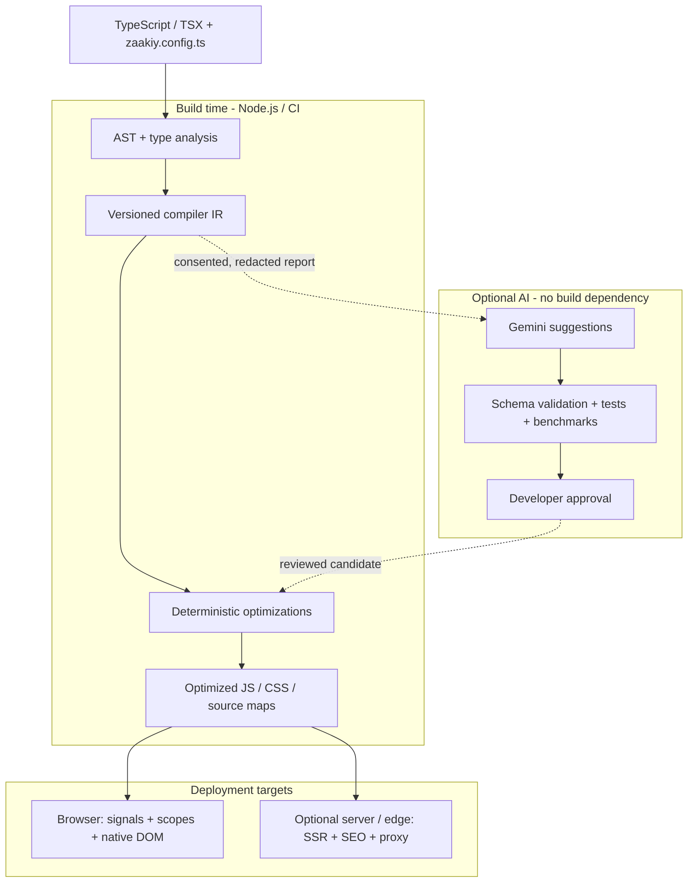

# ZaakiyJS

> **AI-assisted. Compiler-first. Signal-driven. Native DOM.**
>
> **Project status: M0 seven-package contract/toolchain scaffold — runtime, compiler and CLI functionality still not implemented or published.** The APIs, CLI commands, package names and performance budgets below are product targets, not working functionality. No claim is made that ZaakiyJS is the first AI frontend framework.

ZaakiyJS is a proposed, independent **TypeScript/TSX frontend framework** inspired by React, Angular and Vue, designed to compile declarative components into precise native DOM updates. It combines a fine-grained reactive runtime, SOLID/MVVM application architecture, brand-driven CSS, integrated networking/async primitives, hybrid SEO rendering and optional **reviewed Gemini optimization**.

**Repository:** [sanukhandev/zaakiyjs](https://github.com/sanukhandev/zaakiyjs) · **Proposed npm scope:** `@zaakiyjs/*` (ownership not yet verified) · **Engineering rules:** [AGENTS.md](AGENTS.md)

## Why ZaakiyJS?

The product goal is not to copy existing framework APIs. It is to deliver an integrated **verified frontend runtime** where the compiler and development tools can explain and validate signal dependencies, DOM mutations, component lifetimes, asynchronous requests and architectural boundaries.

| Design principle | Intended behavior |
| --- | --- |
| Independent runtime | No required React, Angular, Vue or Zone.js runtime |
| Compiler-first | TSX → AST → semantic analysis → versioned IR → optimized JS/CSS/maps |
| Precise DOM | Hoist static nodes; update only affected text, properties, attributes, class and style |
| One reactive model | Signals, computed values, effects, batching and automatic dependency tracking |
| Hierarchical ownership | App → route → feature → component scopes with deterministic cleanup |
| TypeScript + SOLID/MVVM | Typed Views, signal-backed ViewModels, domain Models, service contracts and adapters |
| Native-first styling | Tailwind-inspired utilities without a Tailwind runtime; brand config drives CSS |
| Optional AI | Gemini proposes changes; local validation, tests, benchmarks and developer review authorize them |
| Independent npm releases | One monorepo, package-specific SemVer, changesets and publish gates |


## Architecture at a glance

GitHub renders the Mermaid source below directly in this README. This is the **planned architecture**, not an implemented build pipeline.



The standard build path is deterministic and works **with AI disabled**. Server-side rendering, dynamic SEO and proxy services are optional; browser runtime code must not import the compiler, AI or server-only modules. For package boundaries and independent npm releases, see the [monorepo guide](docs/development/monorepo-packages.md) and [release runbook](docs/releasing/independent-npm.md).

## Feature specifications

### 1. Compiler and rendering

- Compiler-generated native DOM bindings; **no mandatory Virtual DOM** or component-wide rerenders on a signal change.
- Versioned IR nodes for static markup, reactive text/properties, event handlers, conditionals, keyed lists, components, style tokens and compatibility requirements.
- Static hoisting, safe constant folding, dead-code elimination, dependency narrowing, CSS extraction and code splitting without altering side effects.
- Typed HTML/SVG, typed component props/events, refs, nested composition, stable keyed DOM identity, input focus preservation and source-map diagnostics.
- Deterministic, offline builds with pinned inputs; Vite tooling for development, build and HMR.

### 2. Reactivity, state and lifecycle

- `signal`, lazy `computed`, `effect`, `batch`, `untrack`, scope cleanup and controlled `flushSync`.
- Local state with **top-down unidirectional data flow**; explicit actions/callbacks for writes.
- App-scoped singleton providers for global state, route/feature scoped stores and hierarchical context injection; request-scoped isolation for SSR.
- Lifecycle policies: initialize once per owner, mount, activate, deactivate, KeepAlive, suspend/resume and dispose. Caches are bounded, and effects/listeners/requests must be cleaned up.
- Memoization of derived state and pure expressions, plus lazy component/route/resource loading.

### 3. SOLID, MVVM and page adapters

- **Model:** domain types, business invariants, repository contracts.
- **ViewModel:** owner-scoped signals, derived state, actions, resources, tasks, validation and error states.
- **View:** accessible TSX with declarative bindings and typed callbacks.
- **Page Adapter:** route parameters, data loaders, provider composition, view model construction and SEO/render policy.
- **Infrastructure:** HTTP clients, proxy adapters, cache, storage and external services.
- Architecture-aware CLI scaffolding and planned static checks for forbidden imports, circular dependencies and lifetime violations. Trivial presentational components do not require artificial ViewModels.

### 4. Zaakiy Styles, branding and UI

- An independent **Tailwind-inspired utility CSS compiler**, not a Tailwind wrapper or mandatory dependency.
- One typed `zaakiy.config.ts` for brand identity, colors, typography, spacing, shape, layout, appearance modes and motion.
- Native CSS variables, layers, nesting, responsive/container queries, scoped branding, modern color functions and fluid sizes with browser-aware fallbacks.
- Atomic CSS generation, variant compilation, deduplication, minification, style recipes and explicit handling of dynamic utility classes.
- Optional accessible **UI primitives**, brand-aware components and editable page templates (dashboards, auth, CRUD, settings).
- Optional **Zaakiy Motion**: CSS transitions/keyframes, presence/exit, keyed list/layout animations, view transitions, gestures and springs; reduced motion respected.

### 5. HTTP, secure async and proxy

- Typed Fetch HTTP client with request, response and error **interceptors**, validation, redacted tracing and bounded safe retries.
- Signal-aware `createResource()` reads and `createTask()` mutations, with concurrency policies, cache invalidation, stale-result protection and loading/error states.
- Native **AbortController/AbortSignal** with manual cancellation, navigation/scope disposal, timeouts, merged signals and typed cancellation reasons. Never patch global Promises.
- Optional **server-only Proxy Router** with named upstreams, authentication/authorization, allowlisted egress, SSRF/redirect protections, rate limits and observability. Never bundle secrets into browser code.
- Shared cache/data consistency policies connecting ViewModels, stores, routes and rendered content; server-side idempotency for consequential mutations.

### 6. Routing, server rendering and dynamic SEO

- Client-side and nested routing, page adapters, guards, lazy layouts and route-level data loaders.
- Planned **SSG, SSR, hybrid rendering, hydration and incremental/on-demand regeneration** for dynamic CMS, product, job, article and listing pages.
- Dynamic SEO metadata, canonical URLs, social tags, Schema.org JSON-LD, robots, locale/hreflang and paginated sitemaps.
- Public/private cache separation, correct HTTP status codes, authenticated cache invalidation and indexability auditing.
- Optional analytics, ads and consent packages without tracking or advertising runtime in the framework core.

### 7. AI, verification and developer diagnostics

- Gemini is opt-in and executes in Node/CI only. Advisory analysis and schema-validated optimization proposals never bypass deterministic compilation.
- Candidate IR/CSS optimizations require allowlisted passes, semantic checks, security/accessibility validation, repeated benchmarks and **explicit developer approval**.
- Planned **Verified Runtime** diagnoses scope leaks, stale requests and ownership violations; **Zaakiy Trace** visualizes signal → resource → network → DOM causality.
- Architecture-as-Code and CI contracts track SOLID/MVVM boundaries, runtime size, DOM mutations, accessibility and browser regressions.

## Developer experience (proposed)

### One-command startup

```bash
npx @zaakiyjs/cli@latest start --project my-app
# choose Minimal, Standard or Enterprise preset
cd my-app
pnpm dev
```

**These commands are not yet available on npm.** The command `start --project` creates/scaffolds an app; `zaakiy dev` starts the development server.

### CLI generation

```bash
zaakiy g component UserCard
zaakiy g feature users --architecture mvvm
zaakiy g page products --layout StoreLayout
zaakiy g layout Dashboard
zaakiy g adapter ProductPage
zaakiy g viewmodel Product
zaakiy g model Product
zaakiy g store Cart --scope app
zaakiy g context Workspace
zaakiy g provider Auth
zaakiy g custom-signal UseCounter
zaakiy g service ProductApi
zaakiy g middleware Auth --target route
zaakiy g interceptor AuthToken
zaakiy g proxy Catalog
zaakiy g resource Products --abortable
zaakiy g task SaveProduct --abortable
zaakiy g form Checkout
zaakiy g recipe PrimaryButton
zaakiy g animation FadeUp
zaakiy seo audit
zaakiy analyze architecture
zaakiy ai analyze --consent
```

Generators should create strict, typed artifacts and applicable tests, update imports/routes safely, detect conflicts and support `--dry-run` and noninteractive use.

### Illustrative component syntax

```tsx
import { signal, computed } from "@zaakiyjs/core";
import { mount } from "@zaakiyjs/dom";

function Counter() {
  const count = signal(0);
  const double = computed(() => count.value * 2);

  return (
    <main class="flex flex-col gap-3 p-6">
      <h1 class="text-xl font-bold">Count: {count.value}</h1>
      <p>Double: {double.value}</p>
      <button class="bg-primary rounded-lg px-4 py-2"
              onClick={() => count.value++}>
        Increment
      </button>
    </main>
  );
}

mount(() => <Counter />, document.getElementById("app")!);
```

The intended runtime updates only the two dependent text bindings; the component setup does not execute again on each write. This is a **design illustration**, not compilable current ZaakiyJS code.

## npm package ecosystem

The proposed **26 individually versioned** `@zaakiyjs/*` packages are organized as follows.

| Domain | Modules |
| --- | --- |
| Framework foundation (7) | `core`, `signals`, `dom`, `compiler`, `styles`, `vite-plugin`, `cli` |
| Application architecture (5) | `store`, `forms`, `router`, `compat`, `async` |
| Networking (2) | `http`, `proxy` |
| UI and motion (4) | `ui-primitives`, `ui`, `templates`, `motion` |
| Rendering and monetization (5) | `ssr`, `seo`, `analytics`, `ads`, `consent` |
| AI and quality (3) | `ai`, `devtools`, `testing` |

Only the needed packages should be installed and bundled. These are **planned package boundaries**, not published modules. A separate `create-zaakiyjs` initializer is optional, but `@zaakiyjs/cli start --project` is the chosen public convention.

### Independent npm publication

ZaakiyJS uses a **single repository** and plans **independent SemVer and npm publishing per module**, not synchronized version numbers.

- Each publishable package owns `package.json`, stable exports/types, changelog, README, tests and release artifacts.
- Changesets track package-specific updates and dependency-induced version changes.
- CI validates affected packages **and their dependents**; publication requires pack/install verification, security and API review.
- Publish only changed modules, in dependency order when necessary, using verified npm ownership and preferably npm Trusted Publishing (OIDC).
- No package publication, CI workflow or automated release pipeline is currently configured.

Read the [release runbook](docs/releasing/independent-npm.md) and [package boundary guide](docs/development/monorepo-packages.md).

## Performance and quality targets

**Targets only — no benchmarks have been run.**

| Metric | Initial target |
| --- | --- |
| Minimal reactive + DOM runtime | ≤ 12 KiB gzip, excluding app and optional packages |
| Gemini dependency in browser core | 0 bytes |
| Unrelated DOM mutations after isolated signal update | 0 |
| Owner/lifecycle cleanup | No retained owned effects/listeners after disposal |
| Build reproducibility | Identical hashes with pinned inputs/config |
| Browser validation | Chromium, Firefox, WebKit for declared targets |
| Accessibility | WCAG 2.2 AA-oriented tested component behavior |
| Performance comparisons | Reproducible p50/p95, memory, DOM mutations and gzip/brotli against equivalent workloads |

Quality gates include strict TypeScript, unit tests, compiler golden/behavioral tests, real DOM and Playwright integration, security/privacy checks, SSR/SEO and accessibility tests, and independent package install validation.

## Development roadmap

| Phase | Deliverables |
| --- | --- |
| M0 — Contracts | TSX semantics, IR, signal scheduler, owner scopes, monorepo and CI foundation |
| M1 — Reactive core | Counter/Todo/keyed lists compiled to direct DOM updates with disposal tests |
| M2 — Styling and DX | Brand CSS engine, Vite/HMR, CLI starter and typed diagnostics |
| M3 — Application layer | Stores, MVVM, forms, adapters, routing, HTTP and async cancellation |
| M4 — UI, rendering and server | UI primitives, motion, compatibility, SSG/SSR/hydration, SEO and secure proxy |
| M5 — Verified runtime and AI | Lifecycle diagnostics, causal traces, validated Gemini proposals and measured quality contracts |
| M6 — Beta and ecosystem | Docs, benchmarks, migration, analytics/ads/consent and independent npm releases |

The first implementation slice should be **one typed TSX counter** proving signal → compiler → targeted DOM write → owner cleanup, not a simultaneous implementation of all 26 packages.

## Documentation and contribution

- [Documentation index](docs/README.md)
- [Contributor and agent rules](AGENTS.md)
- [Framework architecture](docs/architecture/overview.md)
- [Compiler and versioned IR](docs/architecture/compiler-and-ir.md)
- [Signals, lifecycle and MVVM](docs/architecture/reactivity-and-mvvm.md)
- [Brand CSS and motion](docs/architecture/styles-and-motion.md)
- [Secure HTTP, async and proxy](docs/architecture/networking-and-async.md)
- [Rendering and dynamic SEO](docs/architecture/rendering-and-seo.md)
- [Gemini trust boundary](docs/architecture/ai-boundary.md)
- [Development roadmap](docs/development/implementation-plan.md)
- [Testing and quality gates](docs/development/testing-and-quality.md)
- [Independent npm release policy](docs/releasing/independent-npm.md)

**Current status:** architecture/docs bootstrap only. Features and package names are planned, and the framework's performance, compatibility and release claims require implementation and evidence.

---

## About the creator

**ZaakiyJS is part of ZaakiyV3RSE.**

**ZaakiyJS** was conceived by **Sanu Khan**, with the goal of creating an independent, compiler-first TypeScript frontend framework focused on precise reactivity, maintainable architecture, and optional verified AI-assisted development.

**Creator's website:** [sanukhan.dev](https://sanukhan.dev)  
**GitHub:** [@sanukhandev](https://github.com/sanukhandev)
