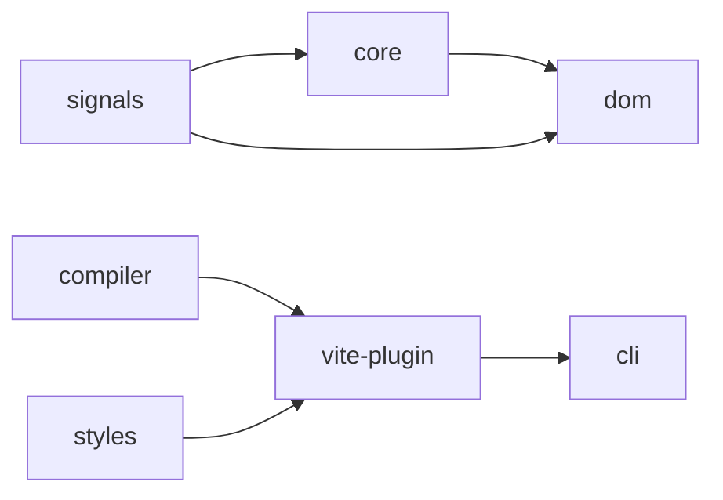

# ZaakiyJS M0 shared contracts — revision 1

**Status:** Historical M0 type-only contract baseline, retained for API ownership and compatibility review. This describes the original starting point, **not** the present implementation state. The seven packages now have executable implementation slices; check their current public exports, tests, and acceptance gates before claiming support.

Implementers must treat this directory and the public types in `packages/*/src` as an inter-package change boundary. Any incompatible change requires an ADR, coordinated type/behavior tests and affected package version intent.

## Symbol ownership

| Public surface (planned; unimplemented) | Owning package | Import boundary |
| --- | --- | --- |
| `signal`, `computed`, `effect`, `batch`, `untrack`, `flushSync` | `@zaakiyjs/signals` | `@zaakiyjs/signals` |
| `createOwner`, `runWithOwner`, `getOwner`, `onCleanup`, `disposeOwner` | `@zaakiyjs/core` | `@zaakiyjs/core` |
| `createContext`, `provide`, `useContext`, `Component`, TSX types | `@zaakiyjs/core` | `@zaakiyjs/core`, `@zaakiyjs/core/jsx-runtime` |
| `mount`, DOM binding and keyed-list runtime | `@zaakiyjs/dom` | `@zaakiyjs/dom`, compiler ABI `@zaakiyjs/dom/compiler` |
| `IR_SCHEMA_VERSION`, serialized IR, `compile`, diagnostics | `@zaakiyjs/compiler` | `@zaakiyjs/compiler` |
| Brand configuration, `extractStyles`, `compileStyles` | `@zaakiyjs/styles` | `@zaakiyjs/styles` |
| `zaakiyPlugin`, virtual CSS module, generated assets | `@zaakiyjs/vite-plugin` | `@zaakiyjs/vite-plugin` |
| `zaakiy` command and generators | `@zaakiyjs/cli` | CLI executable (not yet shipped) |

`@zaakiyjs/core` may provide owner-scoped wrappers/re-exports of signals APIs; `signals` must not import `core`. Value-level exports in this table were *reserved* in M0; their actual implemented availability and support must be checked against the current package exports and behavioral tests.

## Dependency graph

Arrows point from dependencies to consumers. `compiler` and `styles` are build-only; `vite-plugin` and `cli` never enter browser runtime dependency closures. `@zaakiyjs/dom/compiler` is a **runtime ABI subpath**, not an import of the compiler package. No dependency on TypeScript parser internals appears in public IR.

## Read in order

1. [Signals and scheduling](01-signals.md)
2. [Owners, providers, component initialization](02-ownership.md)
3. [Typed TSX source semantics](03-tsx.md)
4. [Compiler-to-DOM ABI](04-dom-abi.md)
5. [Versioned IR and compile result](05-compiler-ir.md)
6. [Style extraction and branding](06-styles.md)
7. [Vite integration and assets](07-vite-plugin.md)
8. [Unresolved decisions](08-open-decisions.md)

## M0 scope and verification

At M0, root `pnpm lint`, `pnpm typecheck`, `pnpm build`, `pnpm test` and frozen install validated metadata and type-only contract stubs. Later implementation PRs added executable compilation, real DOM updates, generated app/build tests, and a Chromium Counter smoke. The packages still use independent versioning (`fixed: []`, `linked: []`) and unpublished `0.0.0` source manifests; publishing remains blocked pending scope, license, browser matrix and artifact review.

## P2 contract-only frozen design (2026-11-05)

The documents below describe **reserved interfaces for future implementations**, not present package exports. They must be read with the [P2 boundary ADR](../adr/0007-p2-ui-contract-boundaries.md) and current compiler restrictions. Follow-up compiler/DOM integrations are tracked in [issue #37](https://github.com/sanukhandev/zaakiyjs/issues/37).

9. [Headless UI primitives](09-ui-primitives.md) — native elements, focus, overlay/portal ownership and controlled state.
10. [Typed UI components](10-ui.md) — TSX composition constraints, brand tokens, recipes and typed actions.
11. [Motion and presence](11-motion.md) — WAAPI/CSS-first cleanup, abort and deferred exit integration.
12. [Templates and generators](12-templates.md) — portable editable source, metadata and deterministic file plans.

There are no implementation packages, API/IR changes, or npm releases in P2-00.
