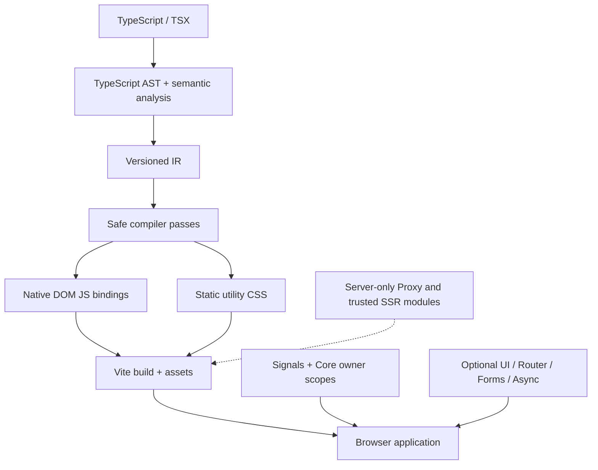

# Architecture, runtime boundaries and known limitations

## Execution architecture

The browser does not run an alternate React/Vue runtime or TypeScript compiler. The generated application updates native text, properties, attributes, classes and styles based on tracked signals, with disposal owned by application/component scopes.

## Package execution boundaries

| Environment | Packages / entrypoints | Important rule |
| --- | --- | --- |
| Browser runtime | `signals`, `core`, `dom`, `store`, `forms`, `router`, `async`, `http`, `ui-primitives`, `ui`, `motion`, `consent`, `ads` | Import only browser-safe public exports; terminate owners on unmount |
| Node build/CI | `compiler`, `styles`, `vite-plugin`, `cli`, `compat` root, `templates/node`, `ssr/build` | No bundling into the deployed browser application |
| Node server | `proxy`, `ssr/node` | Enforce authorization, egress policy, data isolation, request-scoped ownership |
| Browser-safe metadata | `seo` root pure metadata, `ssr` root protocol types, `ssr/client` read-only checks, `templates` manifest/planning, `compat/abort` scoped helpers | A metadata/checking API is not a full runtime implementation |

Always verify the actual `package.json` `exports` and dependency graph before mixing server/client modules.

## Implemented is not the same as production-certified

The reviewed `main` revision contains **22 package directories with source code**, including the merged SEO package. That does not establish that every feature is complete, every CI workflow has passed at the current PR head, or any npm release exists. The package docs consistently distinguish the runtime slice from the remaining integration gates.

## Key current limitations

| Area | Current boundary |
| --- | --- |
| TSX | Constrained compiler grammar; general children/slots, JSX spreads, native refs and dynamic style/class patterns still have documented diagnostics |
| Reactivity | Synchronous effects and lazy computed; asynchronous work belongs to AbortSignal-based Async/HTTP and owner-controlled tasks |
| Routing | Browser router and native view adapters; SPA fallback, real server HTTP status and SSR are external concerns |
| SSR | Trusted server infrastructure exists; compiler-generated reactive TSX SSR and DOM hydration adoption are not yet integrated |
| Compatibility | Standalone analysis and selected explicit helpers; Compiler/Vite cross-graph transform and browser certification remain separate |
| UI | Explicit compositional props pending a broader Compiler/DOM component-children ABI; manual accessibility validation is still necessary |
| Motion | Explicit animations work; compiler pre-removal/Router commit integration is not guaranteed |
| Ads/privacy | No third-party provider SDK automatically loaded; policy compliance and provider data deletion are deployment responsibilities |
| Templates/CLI | Source templates and generators exist; public npm packaging and clean external installs are separately gated |

## Required security practices

- Escape untrusted text; avoid HTML injection sinks and dynamic evaluation.
- Treat cookies, tokens, secrets and upstream origins as server-only.
- Enforce authn/authz, CSRF when applicable, input validation, rate limiting and server-side idempotency.
- Abort and dispose work when route or component owners terminate; cancellation cannot roll back server mutations.
- Apply consent *before* optional scripts, preconnects, analytics, ads or storage are initialized.
- Use CSP, Trusted Types where supported, URL allowlists and explicit runtime validators at the appropriate boundary.

## What to read next

- [Source contract/ADR index](../../contracts/README.md)
- [Architecture overview](../../architecture/overview.md)
- [Compiler and IR design](../../architecture/compiler-and-ir.md)
- [Testing and quality](../../development/testing-and-quality.md)
- [Documentation roadmap](../planned-packages.md)
