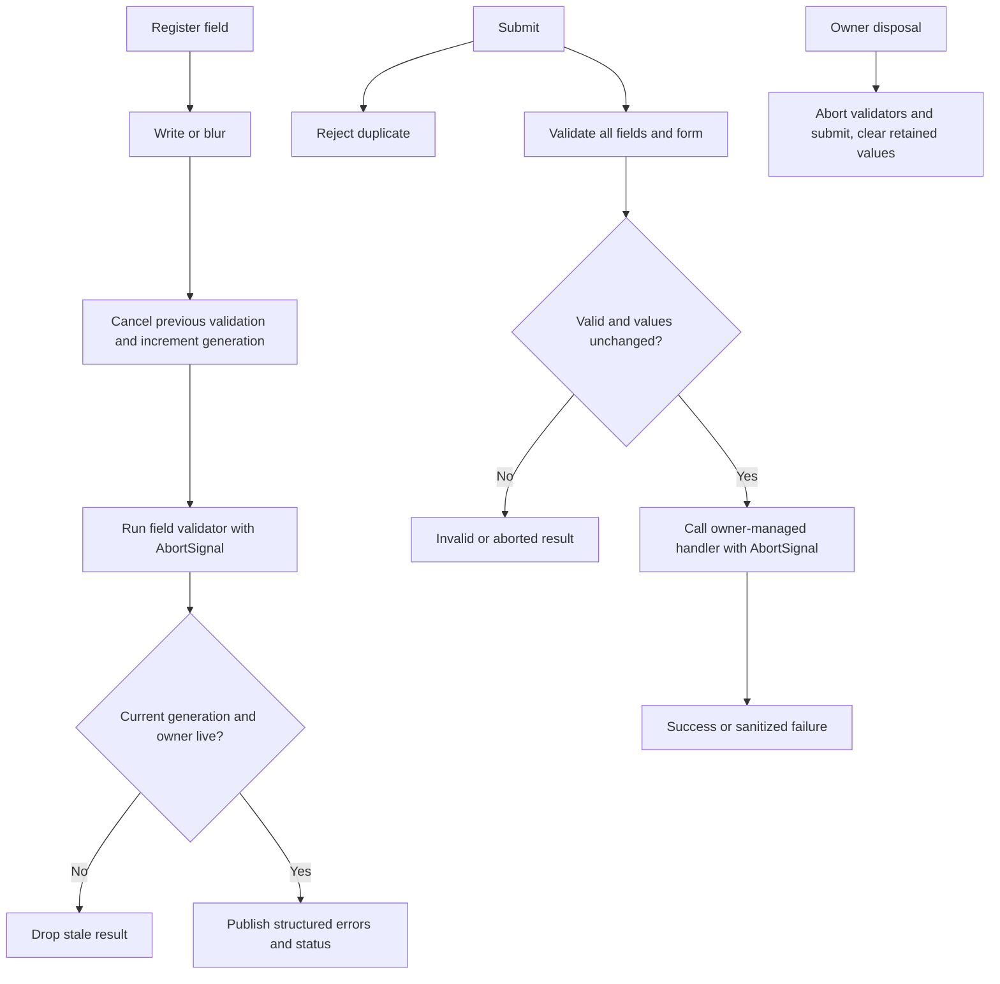

# @zaakiyjs/forms

Headless, signal-driven forms for ZaakiyJS. Framework-facing state uses the existing `@zaakiyjs/signals` runtime and optional `@zaakiyjs/core` owners. No DOM, schema validator, global cache, Promise patch or `@zaakiyjs/async` dependency.

## Typed form + MVVM example

```ts
import { createForm, type ValidationIssue } from '@zaakiyjs/forms';

interface SignupValues {
  email: string;
  password: string;
  confirmation: string;
}
interface SignupRepository {
  register(data: Readonly<SignupValues>, signal: AbortSignal): Promise<{ id: string }>;
}

function createSignupViewModel(repository: SignupRepository) {
  const form = createForm<SignupValues, { id: string }>({
    initialValues: { email: '', password: '', confirmation: '' },
    errorVisibility: 'touched',
    onSubmit: (values, { signal }) => repository.register(values, signal),
    validators: [values => values.password === values.confirmation ? undefined :
      ({ path: 'confirmation', source: 'form', code: 'mismatch', message: 'Passwords differ' } satisfies ValidationIssue)]
  });
  const email = form.field('email', {
    required: 'Enter an email address',
    validateOn: ['change', 'blur'],
    validators: [value => value.includes('@') ? undefined : 'Invalid email']
  });
  const password = form.field('password', { required: true });
  const confirmation = form.field('confirmation', { required: true });
  return { form, email, password, confirmation, save: () => form.submit() };
}
```

Create the ViewModel synchronously inside an owner context (`runWithOwner(owner, ...)`) or pass `{ owner }` explicitly. The form registers an owner cleanup, but lexical ownership **does not** propagate across `await`.

A typed View binds `field.value.value` and `field.visibleErrors.value` in compiler-tracked expressions; call `field.blur()` from an `onBlur` handler. Use `field.ariaInvalid.value`, `field.ariaRequired.value`, `field.disabled.value` and a View-supplied error element ID for `aria-describedby`. The View generates labels, IDs and accessible error messages; forms never produces HTML or attributes.

## API

- `createForm<TValues, TResult>({ initialValues, owner?, onSubmit?, validators?, validateOn?, formValidateOn?, errorVisibility?, validationTimeoutMs?, submitTimeoutMs? })` returns a controller.
- `form.field(path, options?)` registers a typed field; calling again for the same path returns an equivalent handle over the same record. Options apply at first registration. Field handles expose `id`, reactive `path`, writable `value`, `initialValue`, `dirty`, `pristine`, `touched`, `untouched`, `errors`, `visibleErrors`, `pending`, `disabled`, `status`, `ariaInvalid`, and `ariaRequired`; and `blur()`, `validate()`, `setDisabled()`, `dispose()`.
- `form.group(prefix).field(child)` registers a nested typed field and exposes a reactive group value.
- `form.array(path)` exposes reactive immutable `keys`, `insert(index,value)`, `append(value)`, `remove(index)` and `move(from,to)`. Keyed identity is stable across moves. Use `keys` with `<For>` rather than array indices. Field handles move their `path` signals with the item, and existing validation issue paths follow the moved identity. In-flight validators tied to old indices are cancelled. Keys are frozen at runtime to prevent silent mutation. Removal permanently disposes removed item field handles.
- `form.getValue(path)`, `setValue(path,value)`, `setValues(values)`, `reset(values?)` read/write isolated value snapshots. `reset(values)` installs a **new baseline**; `reset()` restores the existing baseline, including original registered array keys.
- `validate()`, `validateField(path)`, `submit()`, `abortSubmit()`, and `dispose()` manage synchronous and asynchronous validation, submissions and cleanup.
- Form signals: `values`, `dirty`, `valid`, `pendingValidation`, `submitting`, `submitted`, `submitSucceeded`, `submitFailure`, `submitCount`, and `errors`.

### Validation semantics

`FieldValidator<T,V>` receives `(value, {path, values, signal})`. A `FormValidator<T>` receives `(values, {signal})`. They may return nothing, a string, a structured issue, a list of issues, or a Promise of those. `required` is provided as a field option. Structured issues use `{code,message,path?,source}`. Failed validators expose `validation_unavailable` or `validation_timeout` as system issues, without leaking exceptions. Cancellation is a distinct `cancelled` result and does not overwrite fresh errors.

Field triggers default to `blur` and `submit`, form-level triggers to `submit`. Explicit `validate()` always runs all registered validators and the form validators. Cross-field revalidation on change uses explicit `dependencies` to avoid revalidating unrelated fields; form-level validation on change is opt-in (`formValidateOn: ['change','submit']`). `visibleErrors` defaults to `touched`; configure `always` or `submitted` for alternative display policy. Validation is not a server-side authorization boundary.

A validation run creates an AbortController, links any caller signal and optional positive timeout, and increments a generation token. New writes cancel superseded field validations; disposal cancels all validators and submissions. Non-cooperative Promise operations are raced against the abort signal, and stale results are discarded. Timeout is represented as system failure; explicit abort returns `cancelled`.

### Submissions

`submit()` returns a typed discriminated result: `success` with the handler value, `invalid` with issues, `duplicate`, `aborted`, or `failed` with a sanitized `{kind,message}`. Duplicate submissions are **ignored** (the second call returns `duplicate`); no automatic retry occurs. The form validates before taking the immutable submission snapshot. Changes during validation abort that submit attempt instead of sending newly unvalidated values.

Throw `new SubmissionValidationError([{ code, message, path, source: 'server' }])` from the ViewModel/repository adapter to map safe domain errors to fields. Other thrown failures become transport errors with a generic presentation-safe message; values remain intact. Retry requires a new explicit `submit()`. The handler must honor its AbortSignal when possible, and the server must implement authorization, input validation and idempotency for consequential mutations.

## Lifecycle



## Limitations and integration notes

- Dotted paths support at most four segments at the type level. The runtime accepts up to sixteen path segments. Array indices are numeric and transient: keep field handles or item keys for stable identity. Nested object and array paths are supported, but implicit mutation of array item order via `setValues` cannot infer stable identity: use `move()` instead. Structural `setValue` of a registered array with a different length is rejected.
- Field, group, and aggregate value reads return independent copies: mutating a returned object cannot silently bypass Signals. Registered field paths must exist in the current form snapshot; initialize optional fields explicitly (including `undefined`) when they should be registerable. Writes through a parent may not change any registered descendant array's structure; use keyed operations instead.
- Server validation errors for an already-submitted snapshot are returned as a result but are not attached to subsequently edited fields. Declared field dependencies also cancel superseded async validations on changes even when automatic `change` validation is disabled.
- The engine expects **structured-cloneable** form values (`structuredClone`); functions, class instances with behavior and cyclic domain graphs are not supported contracts. Avoid storing secrets outside the owner lifetime. The View should avoid storing sensitive input in browser persistence.
- `field()` options are immutable after first registration. Dispose and re-register to replace validators. Disabled fields skip field-level validation; form-level validators must explicitly account for business-specific disabled-field policy.
- Asynchronous cancellation is cooperative for network side effects, but stale writes are rejected even when validators ignore AbortSignal. Do not use form client validation for trust decisions.
- `@zaakiyjs/forms` does **not** render elements. A future DOM adapter must be a separate package and follow the frozen DOM ABI.

## Local checks

```sh
pnpm --filter @zaakiyjs/forms lint
pnpm --filter @zaakiyjs/forms typecheck
pnpm --filter @zaakiyjs/forms build
pnpm --filter @zaakiyjs/forms test
```

Independent release package: `sideEffects: false`, `files: [dist, README.md, CHANGELOG.md]`, ESM exports and declaration files. npm publication requires namespace ownership and release approval.
